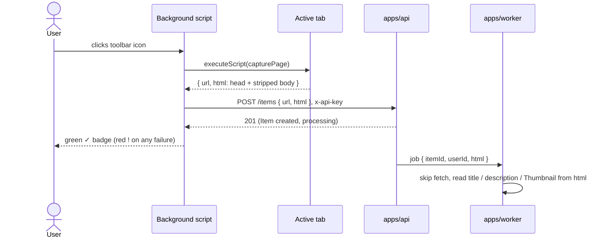

# Browser extension

How `apps/extension` works: a Chrome extension (built with [WXT](https://wxt.dev)) that saves the page a User is looking at as an Item with one click on its toolbar icon. For _why_ capture moved into the browser, see [ADR 0007](./adr/0007-v1-capture-is-a-browser-extension-not-paste-a-link.md) and [Content capture](./content-capture.md). This doc covers what the extension does and how to run and configure it.

## In one picture



## The two click modes

A toolbar icon can either open a popup or fire `chrome.action.onClicked`, never both. Chrome only fires `onClicked` when no popup is set. So `lib/actionPopup.ts` switches the popup on and off at runtime, depending on whether an API key is stored:

| API key stored? | A click on the icon…                                      |
| --------------- | --------------------------------------------------------- |
| No              | opens the **popup** (`entrypoints/popup/`) to paste a key |
| Yes             | **saves the current page**, with no popup                 |

It watches `chrome.storage` for changes, so saving a key in the popup or the options page switches modes immediately.

## Setting the API key

- The User pastes a `resk_…` API key into the popup on first use, or into the **options page** (`entrypoints/options/`, reached from the extension's _Options_ menu entry) to replace it later. Both pages use the same form, `lib/apiKeyForm.ts`.
- The key is stored in `chrome.storage.local` under `resonory_api_key` (`lib/apiKeyStorage.ts`). It uses `.local`, never `.sync`, so a credential never follows the User to other devices through Google account sync.
- There is no key-management UI in `apps/web` yet. See [Getting Started](./getting-started.md) for how to create a key locally.

## What a save does

`saveActiveTab` in `entrypoints/background.ts`:

1. **Reads the stored key.** If there's none, it shows the failure badge.
2. **Captures the tab.** It injects `capturePage()` (`lib/capturePage.ts`) into the active tab with `chrome.scripting.executeScript`, which returns `{ url: location.href, html }`: `document.head` plus a clone of `document.body` with its scripts, styles, `noscript`, `svg`, `iframe` and `template` elements removed (the live page is never modified). The worker reads the head for the title, description and Thumbnail, and the body for the Item's Text. The create-Item schema caps `html` at 5 Mi characters, and `POST /items`' request-body limit is derived from that cap.
3. **Sends it.** It calls `POST <API_BASE_URL>/items` with `{ url, html }` and an `x-api-key` header. `lib/createItemRequest.ts` builds the request as a pure function, so it's unit-tested without any `chrome.*` API.
4. **Shows the result** on the icon's badge (`lib/badge.ts`): a green **✓** that clears after 3 seconds, or a red **!** that stays until the next click. The badge is the only feedback, so the extension needs no notifications permission.

After that, everything is server-side. The API resolves the `x-api-key` header to a User through the same `getSession()` call it uses for Session cookies, creates the Item, and enqueues the job with the captured HTML. The worker uses that HTML instead of fetching the page. See [Content capture](./content-capture.md) for that half.

## Permissions

| Permission  | Why                                                                         |
| ----------- | --------------------------------------------------------------------------- |
| `activeTab` | Gives access to the current tab only, only at the moment of a toolbar click |
| `scripting` | Lets the background script inject `capturePage()` into that tab             |
| `storage`   | Keeps the API key in `chrome.storage.local`                                 |

There are no `host_permissions` and no always-on content script, so the extension can't read any page the User didn't click save on. The call to the API needs no host permission either: it's a cross-origin `fetch` that the API allows through its CORS allow-list (`EXTENSION_ORIGIN`, see [Security](./security.md)).

## Configuring the API address

The extension calls the API at **`WXT_API_URL`**. If that isn't set, it calls `http://localhost:4000`, the same default as `apps/web`'s `NEXT_PUBLIC_API_URL`.

To point it somewhere else, put the value in an env file in `apps/extension/` (see `.env.example`):

| File               | Used by           | Example                                |
| ------------------ | ----------------- | -------------------------------------- |
| `.env`             | every build       | `WXT_API_URL=http://localhost:4100`    |
| `.env.development` | `pnpm dev` only   | `WXT_API_URL=http://localhost:4000`    |
| `.env.production`  | `pnpm build` only | `WXT_API_URL=https://api.resonory.com` |

You can also set it for one run: `WXT_API_URL=https://staging-api.example.com pnpm build`.

Things to know:

- **It's fixed at build time.** WXT inlines the value into the bundle, so after changing it, restart `pnpm dev` or rebuild, then reload the extension in `chrome://extensions`.
- **It's validated.** `lib/apiBaseUrl.ts` accepts only an http(s) URL and drops a trailing slash. An invalid value stops `pnpm dev`/`pnpm build` at startup (the `config:resolved` hook in `wxt.config.ts`) rather than producing an extension that can't reach the API.
- **It isn't a secret.** Anyone who installs the extension can read it from the bundle. That's also why `.env.development`/`.env.production` aren't gitignored, and committing them is fine. Never put an API key there.
- **The API must allow the extension's origin.** Whatever API you point at needs `EXTENSION_ORIGIN` set to this extension's `chrome-extension://<id>` origin ([Environment Variables](./environment-variables.md)), or the browser blocks the request.

## Running it locally

1. Start the API (`pnpm dev` at the repo root), with `EXTENSION_ORIGIN` set in `apps/api/.env`.
2. In `apps/extension`, run `pnpm dev` (WXT watches and rebuilds) or `pnpm build` (writes `.output/chrome-mv3`).
3. In Chrome, open `chrome://extensions`, turn on **Developer mode**, click **Load unpacked**, and pick `apps/extension/.output/chrome-mv3`.
4. Copy the `chrome-extension://<id>` origin Chrome shows into `apps/api/.env` as `EXTENSION_ORIGIN`, and restart the API.
5. Create an API key ([Getting Started](./getting-started.md)), click the toolbar icon, paste it, then click the icon on any page to save it.

## File map

```text
apps/extension/
├── entrypoints/
│   ├── background.ts    # click → capture → POST /items → badge
│   ├── popup/           # first-run API-key entry
│   └── options/         # change an already-stored key
├── lib/
│   ├── actionPopup.ts   # popup vs. click-to-save, by whether a key is stored
│   ├── apiBaseUrl.ts    # validates WXT_API_URL, defaults to localhost:4000
│   ├── apiKeyForm.ts    # the key form both pages share
│   ├── apiKeyStorage.ts # chrome.storage.local read/write/watch
│   ├── badge.ts         # ✓ / ! on the toolbar icon
│   ├── capturePage.ts   # runs in the tab: url + head + stripped body
│   ├── config.ts        # API_BASE_URL, from WXT_API_URL
│   └── createItemRequest.ts # builds the POST /items request
├── .env.example         # WXT_API_URL
└── wxt.config.ts        # manifest, permissions, env check
```

## Not built yet

- **Chrome only.** No Firefox or Safari build is configured.
- **No in-extension sign-in.** The User has to create an API key elsewhere and paste it in.
- **No save history or retry.** A failed save shows a red badge, and the User clicks again.
