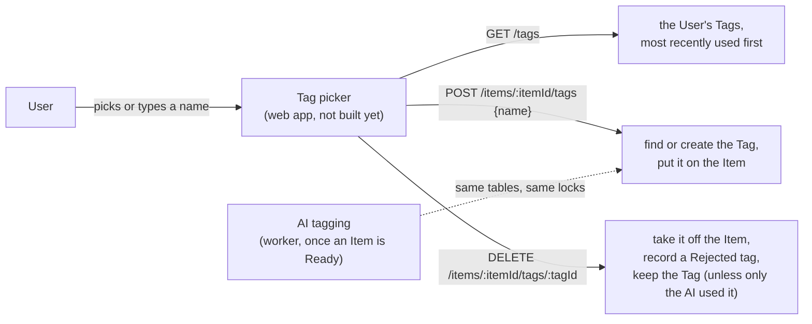

# Tags

How a User organises their Items with Tags: what a Tag is, how one gets created and put on an Item, the rules around it, and why each rule is the way it is. The exact requests, responses and error codes are in [API → Tags](./api.md#tags); the tables and constraints in [Database](./database.md). This doc is the one place that explains the feature as a whole, and the one to read before building on it (AI tagging, filtering by Tag, the web picker).

The design was settled in issue #167 and built in #168–#171 (PR #172). Terms are the Items context's: **Tag**, **Tag name**, **Tag source**, **AI tagging** and **Rejected tag** in its [glossary](./contexts/items/GLOSSARY.md). AI tagging was designed in issue #176 (see [AI tagging](#ai-tagging)). Recording Rejected tags (#177), the AI tagging job itself (#178) and deleting Tags only the AI used (#179) are all built.

## In one picture



## The model

- **A Tag belongs to one User** and can go on any of their Items. It never goes on a Cue: a Cue only brings back an Item, with that Item's Tags.
- **One Tag can be on many Items**, and each link records its **Tag source**: who put that Tag on that Item, `ai` or `user`. The same Tag can come from the AI on one Item and from the User on another.
- **A Tag remembers whether the User ever applied it** (`tags.origin`): `ai` while only the AI has used it, `user` once the User names it or applies it, and never back. Tags from before AI tagging are the User's.
- **A Tag's name is its Tag name**, the slug `slugifyTagName` produces: lowercase, words joined by hyphens, only `a-z 0-9 + # .`, at most 50 characters. "Machine Learning", "machine learning" and "machine-learning" are one Tag, `machine-learning`. There is no separate display name.
- **Tags are flat.** No hierarchy, no folders, no Collections (the roadmap's "no folders, no Collections").

## What a User can do today

The API is built; nothing in a client uses it yet (see [What's not built](#whats-not-built)).

1. **List their Tags** (`GET /tags`), most recently used first, so a picker can offer them before anything is typed. The client filters them as the User types (matching anywhere in the Tag name, compared on the slugified input); there is no server search.
2. **Tag an Item by name** (`POST /items/:itemId/tags`). An existing Tag with that Tag name is reused; an unknown name creates the Tag and puts it on the Item in one step. Either way the Tag is the User's from then on, even one only the AI had used. The response is the Item's Tags after the change.
3. **Take a Tag off an Item** (`DELETE /items/:itemId/tags/:tagId`), whoever put it there. Its Tag name is recorded as a Rejected tag for that Item, so AI tagging won't put it back. A Tag only the AI ever used is deleted once it's on no Items. The response is the Item's remaining Tags.

## Rules, and why

| Rule                                                                                                                                                                                                                                                                                  | Why                                                                                                                                                                                                                                                              |
| ------------------------------------------------------------------------------------------------------------------------------------------------------------------------------------------------------------------------------------------------------------------------------------- | ---------------------------------------------------------------------------------------------------------------------------------------------------------------------------------------------------------------------------------------------------------------- |
| A Tag is created only by tagging an Item with a new name; there is no "create an empty Tag" or manage-Tags page.                                                                                                                                                                      | Pre-made, empty Tags are folders by another name, and Resonory is "save anything, never organise".                                                                                                                                                               |
| Names are stored and shown as the slug.                                                                                                                                                                                                                                               | Near-duplicates (`ML`, `ml`, `M.L.`) can't pile up, and there's one form to match on. A display name would bring back two spellings of one Tag.                                                                                                                  |
| A Tag left on no Items is kept, except a Tag only the AI ever used, which is deleted once it's on no Items: with its last link when it's taken off, or, when its Items were deleted, by the User's next Tag creation. Until then it's left out of `GET /tags` and the AI's Tag names. | It stays in the picker for reuse. It matches the schema, which already keeps Tags when their Items are deleted. Deleting a Tag is a separate, later action. A Tag the User never chose shouldn't linger and be fed back to the AI as one of their own.           |
| Picking a Tag the AI already put on that Item turns the link's source into `user`, and makes the Tag the User's for good.                                                                                                                                                             | The User has confirmed it, and that's worth recording. Once confirmed, it's as much theirs as one they named, so it outlives its links. The link keeps its original time, so confirming doesn't count as a new use in `GET /tags`.                               |
| Taking a Tag off an Item records its Tag name as a Rejected tag for that Item, whoever put it there. It doesn't stop the User putting it back, and counts towards neither limit.                                                                                                      | Once the User has said no to a name on an Item, the AI shouldn't keep reapplying it. Keyed by name, so it survives the Tag being deleted and made again. It only binds the AI: the User can change their mind.                                                   |
| Re-tagging with the same name changes nothing.                                                                                                                                                                                                                                        | Retries and double clicks are harmless, with no duplicates and no errors.                                                                                                                                                                                        |
| "Most recently used" means the latest time the Tag was put on any Item, by the AI or the User, falling back to when the Tag was created. Ties go by Tag name.                                                                                                                         | It surfaces the Tags in active use whoever applied them, and gives Tags on no Items a stable place.                                                                                                                                                              |
| At most 20 Tags per Item and 1,000 per User; going over is `409` with `item_tag_limit` or `user_tag_limit`. Re-adding a Tag already on the Item never counts.                                                                                                                         | Abuse guards that real use won't reach. Separate codes let a client tell the User which limit they hit.                                                                                                                                                          |
| Another User's Item or Tag, or a missing one, is `404`, never `403`.                                                                                                                                                                                                                  | The API doesn't reveal what exists.                                                                                                                                                                                                                              |
| Only the web app's Session may call the Tag routes. A valid API key (the extension's) gets `403 forbidden`; an invalid one `401`.                                                                                                                                                     | A leaked key, long-lived in the extension's storage, can save Items but not read or change a User's Tags. `403`, not `401`, so the extension never takes the refusal as "your key is broken". Extension tagging can be allowed later by relaxing this one guard. |
| An invalid name is `400 validation_failed` with the Tag name rule in the message.                                                                                                                                                                                                     | It's the one validation error a User can fix by retyping, so the client gets a message it can show.                                                                                                                                                              |

## Where the code lives

`apps/api`, layered as in [Clean Architecture](./clean-architecture.md), for the User's side:

```text
domain/
  entities/Tag.ts              Tag, TagLink, AppliedTag, TAG_SOURCES, TAG_ORIGINS
  rules/tagName.ts             slugifyTagName, the Tag name rule
  rules/tagLimits.ts           MAX_TAGS_PER_ITEM, MAX_TAGS_PER_USER
  repositories/ITagRepository.ts
  errors/                      InvalidTagNameError, ItemTagLimitError, UserTagLimitError, ForbiddenError
application/
  use-cases/tags/              TagItemUseCase, UntagItemUseCase, ListTagsUseCase
  dto/tags/                    ItemTagsOutput, ListTagsOutput
infrastructure/
  repositories/DrizzleTagRepository.ts
interface/
  routes/tags.routes.ts        behind sessionOnlyAuthMiddleware
  controllers/TagsController.ts
```

The request and response shapes are in `@resonory/shared/schemas/items` (`TagItemSchema`, `ItemTagParamsSchema`, `UntagItemParamsSchema`, `ItemTagsResponseSchema`, `ListTagsResponseSchema`), and the error codes in `@resonory/shared/schemas/common`. The tables are `tags`, `item_tags` and `rejected_item_tags` in `packages/db/src/schema/tags.ts`.

AI tagging is `apps/worker`'s, layered the same way:

```text
domain/
  entities/Item.ts             TaggableItem (the excerpt the model sees), TAGGING_TEXT_LENGTH
  rules/tagName.ts             the worker's copy of slugifyTagName and the Tag name rule
  rules/tagLimits.ts           the worker's copy of MAX_TAGS_PER_ITEM, MAX_TAGS_PER_USER
  rules/aiTagNames.ts          aiTagNames (cleans the model's answer), MAX_AI_TAGS
  providers/ITagSuggester.ts   the model port
  providers/IQueueProvider.ts  queues the tag-item job
  repositories/ITagRepository.ts
application/
  use-cases/items/TagItemUseCase.ts
infrastructure/
  ai/OpenAiCompatibleTagSuggester.ts, ai/aiTaggingEnv.ts
  queue/BullMqQueueProvider.ts, queue/itemsQueue.ts
  repositories/DrizzleTagRepository.ts   applyAsAi
interface/
  processors/tagItem.processor.ts, processors/tagItemFailed.processor.ts
```

The worker can't import the API, so it keeps its own copy of the Tag name rule and the limits, as it does the Item types; `tests/unit/domain/tag-rules-agreement.test.ts` fails if they drift from the API's or from the `tags` table's check.

## Concurrency

Four things must hold when requests arrive at once. The API's adapter (`DrizzleTagRepository`) guarantees each inside one transaction:

- **One Tag per name per User.** `findOrCreate` locks the User's `users` row, looks up the slug, and inserts with `ON CONFLICT (user_id, name) DO NOTHING`, selecting again if it lost. Two requests creating the same new Tag end with one.
- **At most 1,000 Tags per User.** The same lock on the `users` row is held while counting the User's Tags and inserting.
- **At most 20 Tags per Item.** `applyAsUser` locks the Item's `items` row (`FOR NO KEY UPDATE`, which still lets foreign keys to it be checked), counts the Item's links, then links. The link itself is an upsert that turns an `ai` link into `user` and leaves a `user` link alone.
- **A Tag only the AI used ends up deleted or on an Item, never both.** `removeFromItem` locks the Item's `items` row, then the User's `users` row, before deleting the link and, if it was the last one, the Tag. The AI writer holds the same two locks, in the same order, while it reads the User's Tags and links one, and `findOrCreate` holds the User lock while it makes a Tag the User's. So an untag and the AI putting that Tag on another Item take turns: if the AI goes first, the untag sees its link and keeps the Tag; if the untag goes first, the AI finds no Tag by that name and makes it again. Without the User lock, the untag's delete would wait for the AI's link and then cascade it away.

Two consequences to know:

- **The database doesn't cap an Item's Tags; only the lock and count do.** Any other code that puts Tags on an Item must take the same `items` row lock and count in the same transaction as its insert, or concurrent writes can push an Item past 20. Code that inserts into `tags` must likewise lock the User's row. The AI writer does both (below).
- **A lost race can leave a Tag on no Items.** `TagItemUseCase` checks the Item's count before creating a Tag, so a full Item normally creates nothing. But two requests racing for an Item's last slot both pass that check; the loser gets `409 item_tag_limit`, and the new Tag it created stays, like any Tag taken off its last Item. Both this and the deleted-Item case below exist only because `findOrCreate` and `applyAsUser` commit separately; issue #173 moves them into one transaction (Item lock, then User lock) so neither leaves a Tag behind.

An Item deleted between the use case's ownership check and the link is caught by the same lock: the locked select finds no row, so `applyAsUser` throws `NotFoundError` (a `404`) instead of letting the insert fail its foreign key as a `500`. Once the row is locked, the Item can't be deleted until the transaction ends. If `findOrCreate` had just created the Tag for that request, it stays on no Item, like the lost limit race above: harmless, since Tags outlive their links.

Ownership doesn't depend on the use cases alone: `item_tags` has composite foreign keys to `items (id, user_id)` and `tags (id, user_id)`, so a link can never join one User's Item to another User's Tag. `rejected_item_tags` has the same one to `items (id, user_id)`.

**The AI writer takes the same locks, in one transaction.** The worker's `DrizzleTagRepository.applyAsAi` locks the Item's `items` row, then the User's `users` row (`FOR NO KEY UPDATE`), the order #173 sets for the API and `removeFromItem` already uses, so the writers can't deadlock. A missing Item (deleted before the job ran, or not the User's) finds no row and returns null, and the job skips it quietly. Under both locks it deletes the User's Tags only the AI used that are on no Items (below), drops names rejected for the Item (checked again here, for a rejection recorded while the model was answering; untagging locks the Item's row too, so no rejection of this Item can commit while this runs), reads the User's Tags by name and the Item's links, then, name by name: a Tag already on the Item, from either source, is skipped and takes no place; once the Item has 20 Tags it stops, so no Tag is created that couldn't go on; an unknown name creates the Tag as only the AI's (`origin` `ai`; `ON CONFLICT (user_id, name) DO NOTHING`, then selecting it) unless the User has 1,000, when it's skipped, and an existing Tag's origin is never touched, so a Tag the User applied is never made the AI's; and the link is inserted with `ON CONFLICT DO NOTHING`, so an existing link of either source is never touched. A limit is never an error. It returns the names it put on.

**A Rejected tag is recorded with its link's delete, and a Tag only the AI used goes with its last link.** `removeFromItem` locks the Item's row, then the User's (above), deletes the link and, only if there was one, inserts the Tag's name into `rejected_item_tags` with `ON CONFLICT DO NOTHING`, then deletes the Tag if its `origin` is `ai` and no link to it is left, all in one transaction. So a rejection is never recorded without the link going, or the other way round, rejecting a name twice keeps the first row, and the Rejected tag outlives the deleted Tag (it's keyed by name). Neither limit is involved: it adds no link and no Tag. A Tag only the AI used left on no Items another way (its Items deleted, which cascades its links) is deleted by the User's next Tag creation instead: `findOrCreate`, about to create a Tag, and `applyAsAi`, before it reads the User's Tags, delete every one of the User's `ai` Tags with no link, under the User's lock and before counting, so such a Tag never counts towards the 1,000. The lock makes the delete take turns with every other writer that links an `ai` Tag (the AI writer) or makes one the User's (`findOrCreate`, `removeFromItem`), so it never deletes a Tag being linked; the API's `applyAsUser` doesn't take the User lock, but by then `findOrCreate` has made its Tag the User's, which the delete never touches. Until it's deleted, `listForUser` and the worker's `listNames` leave it out, so `listNames` holds exactly the Tags `applyAsAi` counts, and `aiTagNames` can take its length as the User's count.

## Testing

- **Use cases and routes** are tested over one shared in-memory fake of the Items, Tags, links and Rejected tags (`tests/unit/fakes/tagging.ts`), which behaves like the tables, limits included. See [Testing](./testing.md).
- **The real SQL** is tested against Postgres by `apps/api/tests/integration/infrastructure/repositories/DrizzleTagRepository.test.ts`, on a throwaway database with every migration applied: the same-name race, the `ai` → `user` upsert, the composite foreign keys, the scoped delete and the Rejected tag it records, deleting a Tag only the AI used (including the race against a stand-in for the AI writer that holds its locks with the Tag linked to another Item), the ordering, the limit locks under concurrency, and `applyAsUser` on an Item that no longer exists (the no-row branch only: that test deletes the Item before the call, so it doesn't prove a concurrent delete; the race itself is reproduced in `TagItemUseCase`'s unit test). Run it with `pnpm test:integration` (needs the Compose Postgres; CI runs it too). [Testing](./testing.md#integration-tests-apps-api) lists each check. The AI writer gets the same tests in the worker's `apps/worker/tests/integration/infrastructure/repositories/DrizzleTagRepository.test.ts`, plus a race against a stand-in for `applyAsUser`'s lock, a race against a stand-in for `removeFromItem` deleting the Tag as the AI puts it on, the Item cap, Tags created as only the AI's, and an existing `user` link left untouched ([Testing](./testing.md#integration-tests-apps-worker)). The AI tagging use case is unit-tested over hand-written fakes (`TagItemUseCase.test.ts`).
- **By hand**, `apps/api/bruno/` has a request for every Tag route, including the API-key refusal (see [Getting Started](./getting-started.md)).

## What's not built

- **The web Tag picker.** It needs sign-in in `apps/web` and `GET /items` in the API first; neither exists.
- **Tagging from the extension**, at save time or later. The API refuses API keys on these routes on purpose (see above).
- **Renaming, deleting and merging Tags.** Renaming onto an existing name would hit `tags_user_id_name_unique`, so a rename will need a merge rule.
- **Filtering Items by Tag** (roadmap item 9). The `item_tags_tag_id_idx` index already serves "every Item with this Tag".

## AI tagging

Settled in a grilling session (issue #176) and built by #177, #178 and #179. How the job runs is in [Queue → AI tagging](./queue.md#ai-tagging). What's sent to the model, and why Groq, is [Items ADR 0004](./contexts/items/adr/0004-ai-tagging-sends-an-item-excerpt-to-a-third-party-model.md).

- **When.** Once Processing marks an Item Ready, the worker queues a `tag-item` job (see [Queue](./queue.md)). It's separate from Processing, so a slow or failing model never delays Ready or makes an Item Failed. A final failure is only logged; the User sees an Item without AI Tags. A Failed Item retried to Ready is tagged again. New saves only: existing Items aren't backfilled. There's no per-User setting in v1.
- **What the model sees.** Title, description, Source URL (without its query string, fragment or credentials: a signed link or token can live there, and the host and path are enough to tag with), Item type, the first ~4,000 characters of Text, and the User's 200 most recently used Tag names (but not a Tag only the AI used that's on no Items, which the next Tag creation deletes). A name beyond the 200 is still reused if the model answers with it; the cap only keeps a call small. An Item without Text is still tagged from the rest.
- **What it does.** It puts 0–3 Tags on the Item with source `ai`, applied directly (not suggestions). It reuses one of the User's Tags whenever one fits and makes a new Tag only when none does. Names go through `slugifyTagName` and are deduped; a Tag already on the Item, from either source, is left alone. Zero Tags is a valid answer when the model isn't confident.
- **Rejected tags (built, #177).** Taking any Tag off an Item, whoever put it there, records that Tag _name_ as rejected for that Item (`rejected_item_tags`), and the AI never puts it back. It's keyed by name, not Tag id, so the rejection survives the Tag being deleted (below) and made again.
- **Tags only the AI used (built, #179).** A Tag the AI created and the User never applied themselves (`tags.origin` `ai`) is deleted once it's taken off its last Item, in the same transaction as the untag and the Rejected tag, so rejected inventions don't pile up and come back as "existing Tags" for the AI to reuse. One left on no Items by its Items' deletion is deleted by the User's next Tag creation (API or AI), before it counts their Tags, so it never takes one of the 1,000; until then it's left out of `GET /tags` and the Tag names sent to the model. Naming the Tag or confirming the AI's link (`POST /items/:itemId/tags`) makes it the User's for good.
- **Limits.** The AI writer takes the Item's `items` row lock, then the User's `users` row lock, in one transaction: the order #173 sets for the API, so the two writers can't deadlock (see [Concurrency](#concurrency)). At the 1,000-Tag cap it only reuses existing Tags; at the 20-Tag Item cap it adds nothing. It never fails on a limit. It has the same concurrency tests as `applyAsUser`.
- **The model.** Groq's free tier by default, through the `openai` package and a worker port, so another OpenAI-compatible provider is only `AI_TAGGING_BASE_URL`, `AI_TAGGING_API_KEY` and `AI_TAGGING_MODEL` ([Environment Variables](./environment-variables.md#appsworkerenv)). Without a key, AI tagging is off and each job logs that at info. The model answers in JSON mode; its names are cleaned as above, so it can't add more than 3 Tags or an invalid name.

## Open questions

- **Should confirming an AI Tag count as a use?** Today it doesn't move the Tag up `GET /tags`, because the link keeps its original time. That follows #167's wording; revisit if the picker feels wrong.
