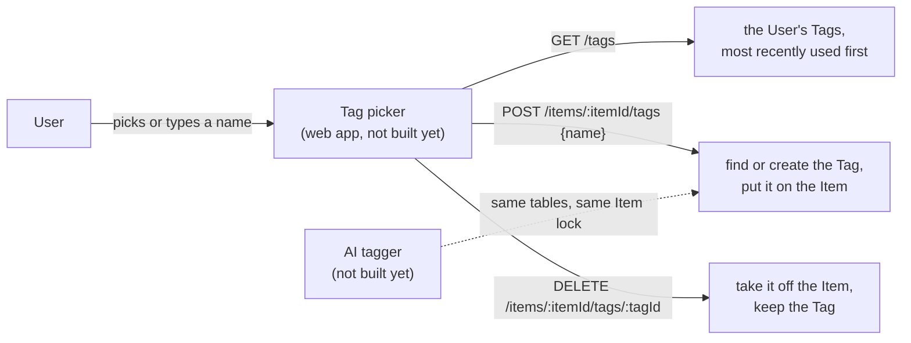

# Tags

How a User organises their Items with Tags: what a Tag is, how one gets created and put on an Item, the rules around it, and why each rule is the way it is. The exact requests, responses and error codes are in [API → Tags](./api.md#tags); the tables and constraints in [Database](./database.md). This doc is the one place that explains the feature as a whole, and the one to read before building on it (AI tagging, filtering by Tag, the web picker).

The design was settled in issue #167 and built in #168–#171 (PR #172). Terms are the Items context's: **Tag**, **Tag name** and **Tag source** in its [glossary](./contexts/items/GLOSSARY.md).

## In one picture



## The model

- **A Tag belongs to one User** and can go on any of their Items. It never goes on a Cue: a Cue only brings back an Item, with that Item's Tags.
- **One Tag can be on many Items**, and each link records its **Tag source**: who put that Tag on that Item, `ai` or `user`. The same Tag can come from the AI on one Item and from the User on another.
- **A Tag's name is its Tag name**, the slug `slugifyTagName` produces: lowercase, words joined by hyphens, only `a-z 0-9 + # .`, at most 50 characters. "Machine Learning", "machine learning" and "machine-learning" are one Tag, `machine-learning`. There is no separate display name.
- **Tags are flat.** No hierarchy, no folders, no Collections (the roadmap's "no folders, no Collections").

## What a User can do today

The API is built; nothing in a client uses it yet (see [What's not built](#whats-not-built)).

1. **List their Tags** (`GET /tags`), most recently used first, so a picker can offer them before anything is typed. The client filters them as the User types (matching anywhere in the Tag name, compared on the slugified input); there is no server search.
2. **Tag an Item by name** (`POST /items/:itemId/tags`). An existing Tag with that Tag name is reused; an unknown name creates the Tag and puts it on the Item in one step. The response is the Item's Tags after the change.
3. **Take a Tag off an Item** (`DELETE /items/:itemId/tags/:tagId`), whoever put it there. The response is the Item's remaining Tags.

## Rules, and why

| Rule                                                                                                                                                          | Why                                                                                                                                                                                                                                                              |
| ------------------------------------------------------------------------------------------------------------------------------------------------------------- | ---------------------------------------------------------------------------------------------------------------------------------------------------------------------------------------------------------------------------------------------------------------- |
| A Tag is created only by tagging an Item with a new name; there is no "create an empty Tag" or manage-Tags page.                                              | Pre-made, empty Tags are folders by another name, and Resonory is "save anything, never organise".                                                                                                                                                               |
| Names are stored and shown as the slug.                                                                                                                       | Near-duplicates (`ML`, `ml`, `M.L.`) can't pile up, and there's one form to match on. A display name would bring back two spellings of one Tag.                                                                                                                  |
| A Tag left on no Items is kept.                                                                                                                               | It stays in the picker for reuse. It matches the schema, which already keeps Tags when their Items are deleted. Deleting a Tag is a separate, later action.                                                                                                      |
| Picking a Tag the AI already put on that Item turns the link's source into `user`.                                                                            | The User has confirmed it, and that's worth recording. The link keeps its original time, so confirming doesn't count as a new use in `GET /tags`.                                                                                                                |
| Re-tagging with the same name changes nothing.                                                                                                                | Retries and double clicks are harmless, with no duplicates and no errors.                                                                                                                                                                                        |
| "Most recently used" means the latest time the Tag was put on any Item, by the AI or the User, falling back to when the Tag was created. Ties go by Tag name. | It surfaces the Tags in active use whoever applied them, and gives Tags on no Items a stable place.                                                                                                                                                              |
| At most 20 Tags per Item and 1,000 per User; going over is `409` with `item_tag_limit` or `user_tag_limit`. Re-adding a Tag already on the Item never counts. | Abuse guards that real use won't reach. Separate codes let a client tell the User which limit they hit.                                                                                                                                                          |
| Another User's Item or Tag, or a missing one, is `404`, never `403`.                                                                                          | The API doesn't reveal what exists.                                                                                                                                                                                                                              |
| Only the web app's Session may call the Tag routes. A valid API key (the extension's) gets `403 forbidden`; an invalid one `401`.                             | A leaked key, long-lived in the extension's storage, can save Items but not read or change a User's Tags. `403`, not `401`, so the extension never takes the refusal as "your key is broken". Extension tagging can be allowed later by relaxing this one guard. |
| An invalid name is `400 validation_failed` with the Tag name rule in the message.                                                                             | It's the one validation error a User can fix by retyping, so the client gets a message it can show.                                                                                                                                                              |

## Where the code lives

`apps/api`, layered as in [Clean Architecture](./clean-architecture.md):

```text
domain/
  entities/Tag.ts              Tag, TagLink, AppliedTag, TAG_SOURCES
  rules/tagName.ts             slugifyTagName, the Tag name rule
  rules/tagLimits.ts           MAX_TAGS_PER_ITEM, MAX_TAGS_PER_USER
  repositories/ITagRepository.ts
  errors/                      InvalidTagNameError, ItemTagLimitError, UserTagLimitError, ForbiddenError
application/
  use-cases/tags/              TagItemUseCase, UntagItemUseCase, ListTagsUseCase
  dto/tags/                    ItemTagsOutput, ListTagsOutput
infrastructure/
  repositories/DrizzleTagRepository.ts
interface/
  routes/tags.routes.ts        behind sessionOnlyAuthMiddleware
  controllers/TagsController.ts
```

The request and response shapes are in `@resonory/shared/schemas/items` (`TagItemSchema`, `ItemTagParamsSchema`, `UntagItemParamsSchema`, `ItemTagsResponseSchema`, `ListTagsResponseSchema`), and the error codes in `@resonory/shared/schemas/common`. The tables are `tags` and `item_tags` in `packages/db/src/schema/tags.ts`.

## Concurrency

Three things must hold when requests arrive at once. The adapter (`DrizzleTagRepository`) guarantees each inside one transaction:

- **One Tag per name per User.** `findOrCreate` locks the User's `users` row, looks up the slug, and inserts with `ON CONFLICT (user_id, name) DO NOTHING`, selecting again if it lost. Two requests creating the same new Tag end with one.
- **At most 1,000 Tags per User.** The same lock on the `users` row is held while counting the User's Tags and inserting.
- **At most 20 Tags per Item.** `applyAsUser` locks the Item's `items` row (`FOR NO KEY UPDATE`, which still lets foreign keys to it be checked), counts the Item's links, then links. The link itself is an upsert that turns an `ai` link into `user` and leaves a `user` link alone.

Two consequences to know:

- **The database doesn't cap an Item's Tags; only the lock and count do.** Any other code that puts Tags on an Item, the AI tagger first, must take the same `items` row lock and count in the same transaction as its insert, or concurrent writes can push an Item past 20. Code that inserts into `tags` must likewise lock the User's row.
- **A lost race can leave a Tag on no Items.** `TagItemUseCase` checks the Item's count before creating a Tag, so a full Item normally creates nothing. But two requests racing for an Item's last slot both pass that check; the loser gets `409 item_tag_limit`, and the new Tag it created stays, like any Tag taken off its last Item.

An Item deleted between the use case's ownership check and the link is caught by the same lock: the locked select finds no row, so `applyAsUser` throws `NotFoundError` (a `404`) instead of letting the insert fail its foreign key as a `500`. Once the row is locked, the Item can't be deleted until the transaction ends.

Ownership doesn't depend on the use cases alone: `item_tags` has composite foreign keys to `items (id, user_id)` and `tags (id, user_id)`, so a link can never join one User's Item to another User's Tag.

## Testing

- **Use cases and routes** are tested over one shared in-memory fake of the Items, Tags and links (`tests/unit/fakes/tagging.ts`), which behaves like the tables, limits included. See [Testing](./testing.md).
- **The real SQL has no committed tests**: the API has no database-backed tests yet. The same-name race, the `ai` → `user` upsert, the foreign keys, the scoped delete, the ordering and the limit locks were checked by hand against throwaway local databases; [Testing](./testing.md) lists each check and its result. Re-run them after changing `DrizzleTagRepository`.
- **By hand**, `apps/api/bruno/` has a request for every Tag route, including the API-key refusal (see [Getting Started](./getting-started.md)).

## What's not built

- **The web Tag picker.** It needs sign-in in `apps/web` and `GET /items` in the API first; neither exists.
- **Tagging from the extension**, at save time or later. The API refuses API keys on these routes on purpose (see above).
- **Renaming, deleting and merging Tags.** Renaming onto an existing name would hit `tags_user_id_name_unique`, so a rename will need a merge rule.
- **Filtering Items by Tag** (roadmap item 9). The `item_tags_tag_id_idx` index already serves "every Item with this Tag".
- **AI tagging.** It writes links with source `ai`, and must follow the locking rule above.

## Open questions

- **Can a Tag the User removed come back from the AI?** Today removal only deletes the link, so a later AI run could add it again. Decide when AI tagging is designed: remembering a removal needs somewhere to record it.
- **Should confirming an AI Tag count as a use?** Today it doesn't move the Tag up `GET /tags`, because the link keeps its original time. That follows #167's wording; revisit if the picker feels wrong.
